<p align="center">
  
</p>

<h1 align="center">Plynth</h1>

<p align="center">
  Turn a 2D floor plan image into a game-ready 3D building, fast.<br>
  Use it from the app, or let your AI agent drive it from the command line.
</p>

<p align="center">
  <a href="https://github.com/ManideepKadambari-Dev/plynth/releases/latest"></a>
  <a href="LICENSE"></a>
  
  <a href="https://github.com/ManideepKadambari-Dev/plynth/actions/workflows/build.yml"></a>
</p>

<p align="center">
  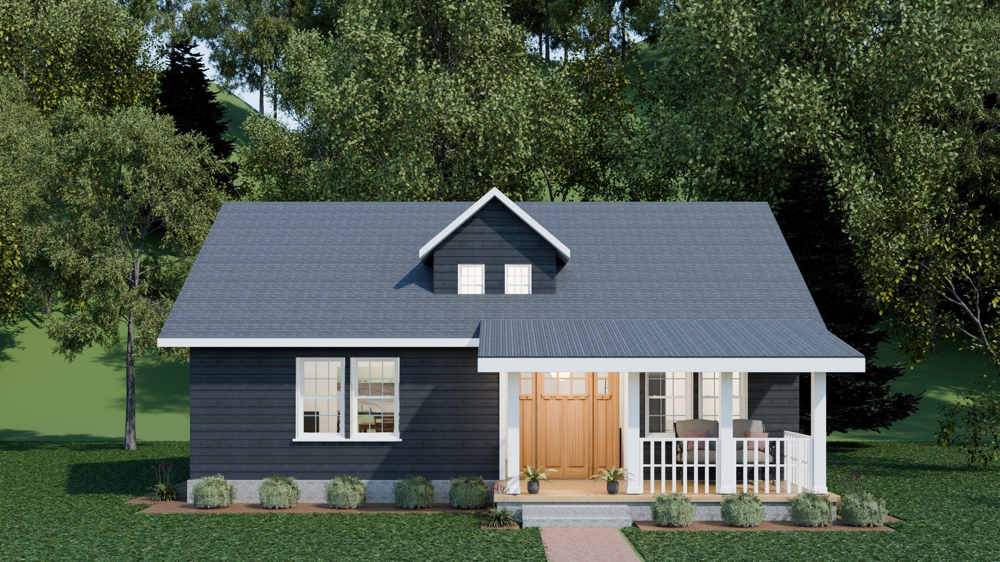
  <br>
  <sub>A cottage drawn, furnished and built with Plynth, with BlenderKit furniture, doors and windows. The garden, porch roof, deck and steps were added in Blender for this picture.</sub>
</p>

Detect or draw walls, add rooms, doors, windows, stairs, roofs, furniture and materials, and Plynth builds it. Look at the result in the 3D view, then export FBX with textures and collision for your game engine. Unreal Engine is the main target: the export and its quality checks follow Unreal's rules for scale, naming, pivots and `UCX_` collision.

Everything the app does is also a command that answers in one line of JSON, so a script or your own AI coding assistant can make buildings without the window.

**How it works.** The plan is kept in metres in a plain JSON project. When you press Build, Plynth uses Blender underneath, in the background with no window, to make the geometry, materials and collision, then shows the result in its own 3D view. You install Blender once; Plynth finds it and runs it for you.

## From plan to finished house

| | | |
|:---:|:---:|:---:|
| 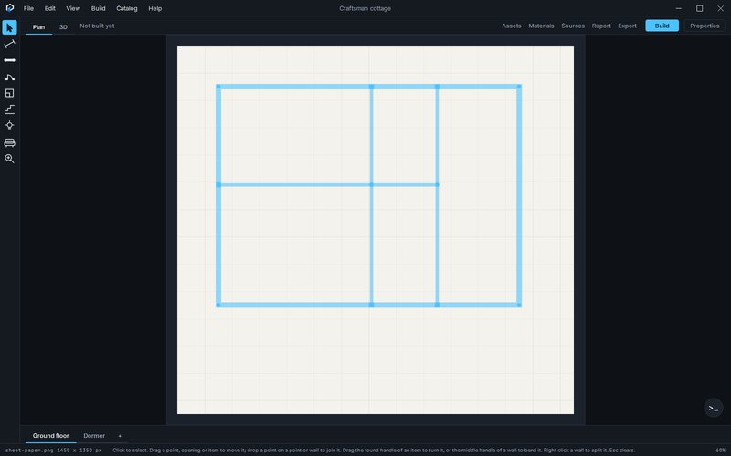 | 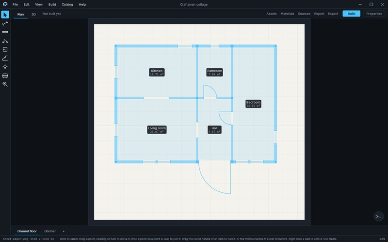 | 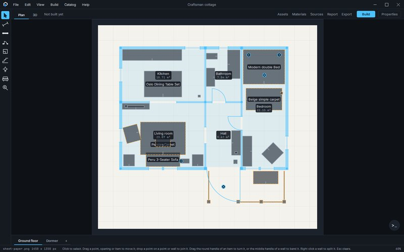 |
| **1. Walls.** Draw them, or detect them from a plan image. | **2. Rooms, doors and windows.** Rooms get names and areas. | **3. Furnish.** Furniture, lights, columns and railings. |
| 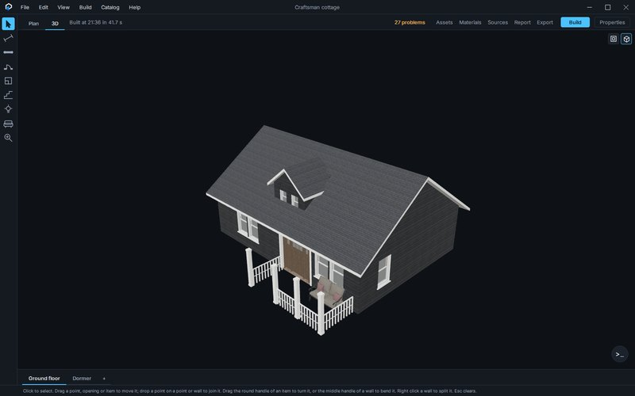 | 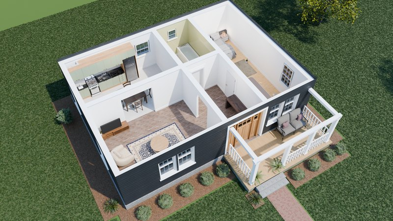 | 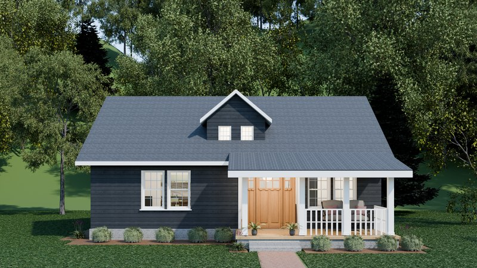 |
| **4. Build.** One click, then Plynth's 3D view. | **5. Every room inside.** The same build, roof hidden. | **6. Finished.** Export to your game engine, or render it. |

## Features

**Plan**
- Load a PNG, JPEG or BMP plan, pan and zoom, and set the scale by clicking both ends of a length you know.
- Detect walls, doors, windows and rooms from the image with a few sliders, then fix the result by hand. Or draw the walls yourself.
- Points line up with nearby points while you draw, so walls come out straight. Curved walls and rounded corners too.
- Rooms with types such as bedroom, kitchen and bathroom. A wall drawn across a room splits it in two.
- Doors, windows and gaps, with opening shapes you can add, and a wall view to see each wall from the side.
- Several floors, with straight, L shape, U shape and spiral stairs, and flat, gable, hip, shed and sawtooth roofs.

**Build**
- One click builds the whole building: walls, cut openings with doors and windows, floors, ceilings, slabs, stairs and roofs.
- A real 3D preview of the result. Orbit it, or fly through it with the right mouse button and W, A, S, D, like in Unreal Engine.
- A build report lists anything that was left out. Click a line to see it on the plan.

**Furnish and materials**
- An assets catalog of your own model files, with thumbnails, in a library folder you control.
- Optional imports from BlenderKit, with your own account, and from Fab zip files.
- A materials catalog with paint, brick, wood, tile, concrete, steel and glass, and different looks for the inside and outside of a wall.
- Generators for things such as columns and cabinets, plus set dressing, variations, light markers and trim.

**Export for your game engine** (main target: Unreal Engine)
- One FBX with applied transforms, named material slots such as `Living_Floor`, a `Textures` folder and `UCX_` collision shapes.
- Grouped export: one FBX for each group of walls, floors and room furniture, which you can rename, merge and rearrange.
- Modular kit: each unique wall, corner and opening piece written once, with a layout file that says where every copy goes.
- Quality checks run before anything is written: scale, transforms, naming, UVs, texture sharpness, triangles, materials, collision and more.
- Optional gameplay data: room volumes, door positions and light positions as JSON.

**Command line and automation**
- `plynth` does everything the app does, from a terminal or a script. Every command prints one line of JSON.
- `plynth render` saves a picture of the last build, and `plynth render --plan` saves the plan with every mark drawn on it.
- An edit session lets the app and a script work on the same project without overwriting each other.
- Let your AI agent drive it: each new project gets an `AGENTS.md` guide, so your own coding assistant can build and check buildings through the command line.

## Screenshots

| | |
|:---:|:---:|
| 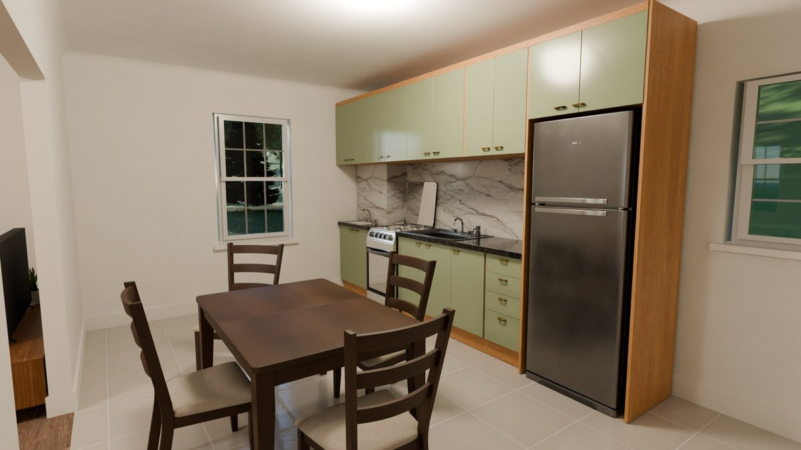 | 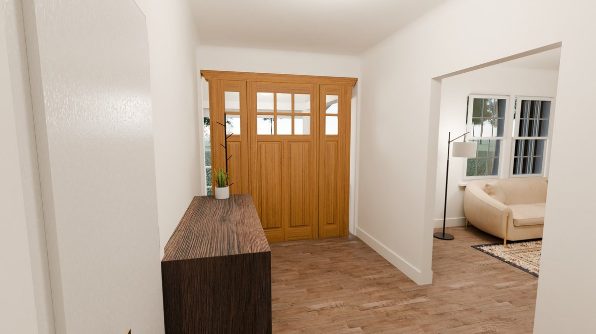 |
| The kitchen, furnished with Plynth. | The hall, looking into the living room. |
| 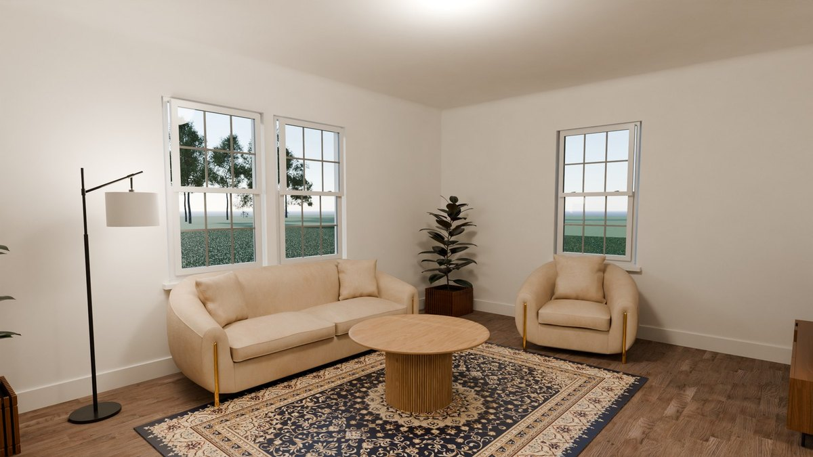 | 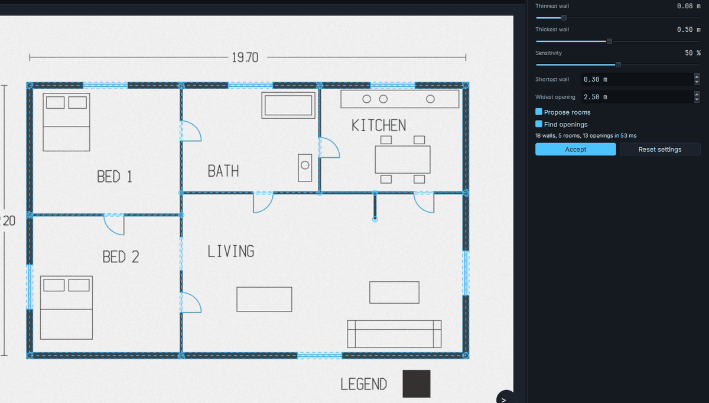 |
| The living room. | Detect walls, doors, windows and rooms from a plan image. |
| 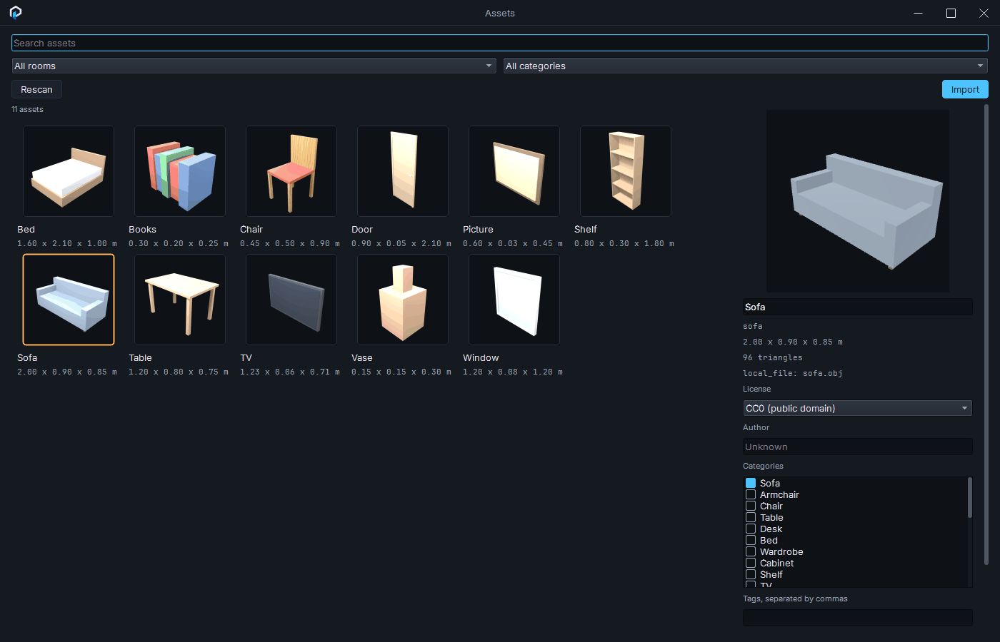 | 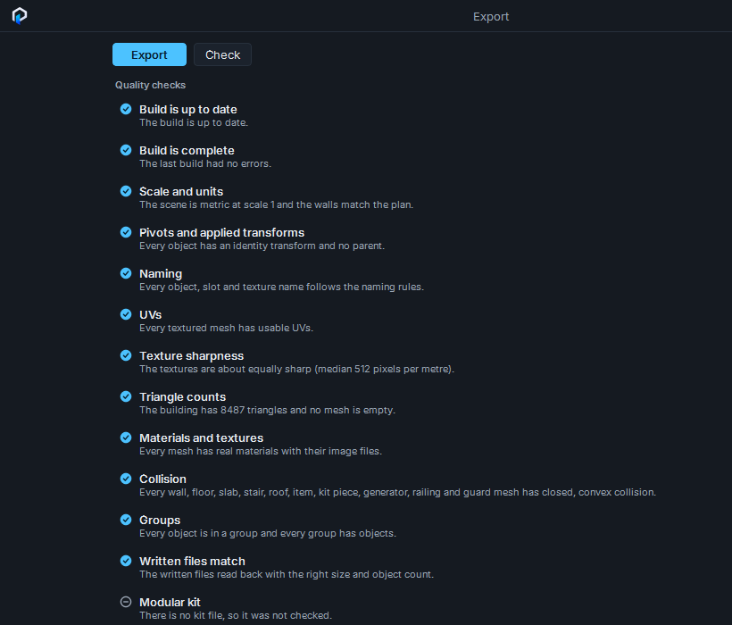 |
| The assets catalog. | Quality checks before the FBX is written. |

Rooms were rendered in Blender from Plynth's build; only the camera, the lights and the world outside were added for the pictures.

## Download and install

Get the latest version from the [releases page](https://github.com/ManideepKadambari-Dev/plynth/releases/latest).

- `PlynthSetup.exe` is the installer. It installs for your user only, needs no administrator rights, adds a Start menu entry and puts `plynth` on your command line path.
- `Plynth-<version>-windows-x64.zip` is the portable copy. Unpack it anywhere and run `plynth.exe`.

Requirements:

- Windows 10 or 11, 64-bit.
- [Blender](https://www.blender.org/download/) 4.2 or newer, installed separately. Plynth uses it underneath to build, finds it on first run and never installs it for you.
- The Microsoft Visual C++ runtime (x64), if your PC does not have it yet. The installer links to Microsoft's page.

The program is not code signed yet, so Windows SmartScreen may warn the first time: choose "More info", then "Run anyway". An installed copy can update itself from Help, Check for updates, and every update is checked against a signature before it runs.

## Quick start

1. Install Blender, start Plynth and follow the setup check. Press **Create** for the library and projects folders.
2. Open the **Catalog** menu and choose **Add the sample items** to get the sample furniture and materials.
3. On the home screen, click **Apartment** under **Sample projects**.
4. Press **Build**, or Ctrl+B. The 3D view opens when the building is ready.
5. Press **Export**, or Ctrl+E. Plynth writes `Apartment.fbx`, a `Textures` folder and a report into the project's `export` folder.
6. In Unreal Engine, import the FBX with Combine Meshes off and keep `Textures` beside it.

For your own drawing, press **New project**, set the plan image from the floor tab, set the scale with **S** and detect walls with **D**. [Getting started](docs/GETTING_STARTED.md) walks through both in about ten minutes.

## Command line

The same steps from a terminal:

```
plynth samples add
plynth samples open apartment --to D:\Work
plynth build --project D:\Work\Apartment
plynth export --project D:\Work\Apartment
```

Every command answers with one line of JSON, so a script can read the result. The `export` answer, shortened:

```json
{"ok":true,"command":"export","result":{"ok":true,"exported":true,"exporter":"single","collision_objects":62,"outputs":{"files":[{"group":"building","name":"Apartment","file":"Apartment.fbx","objects":151,"triangles":8487}],"texture_count":101},"quality":{"passed":true,"fail_count":0,"warning_count":0}}}
```

A refusal has `"ok":false` and an error with a short `code` and a plain sentence:

```json
{"ok":false,"command":"wall add","error":{"code":"not_found","message":"There is no point p9."}}
```

The [Command line guide](docs/CLI_GUIDE.md) covers every command. To let your own coding assistant build and check buildings through the command line, see [Using an AI coding assistant with Plynth](docs/AI_INTEGRATION.md).

## Documentation

The same pages open inside the app with F1.

- [Getting started](docs/GETTING_STARTED.md): from install to your first export.
- [User guide](docs/USER_GUIDE.md): every screen and feature.
- [Keyboard shortcuts](docs/SHORTCUTS.md): keys and mouse actions.
- [Command line guide](docs/CLI_GUIDE.md): every command and its answer.
- [Setting up Plynth](docs/SETUP.md): the setup check, Blender and the library.
- [Writing generators](docs/GENERATORS.md): add generators, opening shapes, importers and material importers.
- [Using an AI coding assistant](docs/AI_INTEGRATION.md): drive Plynth from your own assistant.

## Status and roadmap

Plynth is an early preview. It works from plan to export, but every release opens projects saved by older releases and keeps your old files in a backup folder (see [docs/COMPATIBILITY.md](docs/COMPATIBILITY.md)), and import into Unreal Engine is untested for this release. Keep a copy of projects you care about.

- Planned work and known problems are in the [issues](https://github.com/ManideepKadambari-Dev/plynth/issues) and [milestones](https://github.com/ManideepKadambari-Dev/plynth/milestones).
- To report a bug, [open an issue](https://github.com/ManideepKadambari-Dev/plynth/issues/new/choose) with the Plynth version (Help, About Plynth, or `plynth version`), the steps, what you expected and what happened. A project or plan image that shows the problem helps a lot.

## Building from source

### Prerequisites

- Visual Studio 2026 with the "Desktop development with C++" workload.
- Git.
- vcpkg, with the `VCPKG_ROOT` environment variable pointing at its folder.
- Qt 6.8 with the MSVC 64-bit kit, with the `QTDIR` user environment variable pointing at the kit folder, for example `C:\Qt\6.8.3\msvc2022_64`.

Get Qt from the Qt online installer (free account needed), or with `aqtinstall` if you prefer no login:

```
pip install aqtinstall
python -m aqt install-qt windows desktop 6.8.3 win64_msvc2022_64 -O C:\Qt
```

Set `VCPKG_ROOT` and `QTDIR` as user variables, then restart any open terminal or Visual Studio so they are picked up.

### Visual Studio

1. Start Visual Studio after the variables are set.
2. File > Open > Folder, and pick the repository folder.
3. Choose the `msvc` configure preset and the Debug configuration.
4. Choose `plynth.exe` as the startup item and press F5.

The first configure downloads and builds the vcpkg packages, so it takes a few minutes. One of them, libvterm (used by the built-in terminal), comes from the overlay port in `ports/`. vcpkg finds it through `vcpkg-configuration.json`, so there is nothing extra to install.

### Command line

The presets use the Ninja generator, which needs the Visual Studio C++ environment. Run these from the Developer PowerShell for Visual Studio, where CMake and Ninja are on PATH:

```
cmake --preset msvc
cmake --build --preset debug
ctest --preset debug
```

From any other terminal, put `tools\msvc-env.cmd` in front of each command. It loads the environment, then runs the command at low CPU priority with at most 6 build threads:

```
tools\msvc-env.cmd cmake --preset msvc
tools\msvc-env.cmd cmake --build --preset debug
```

To build in another folder, add `-B out/build/<name>` to the configure command.

The app is built to `out/build/msvc/app/Debug/plynth.exe`. Next to it is `plynth.com`, a small console program with the same command line. Use it from a terminal so the answer is printed before the prompt returns.

### Screenshots of the window

`plynth.exe --screenshot <file> --size <WxH>` opens the window, saves a PNG of it at that size and exits:

```
plynth.exe --screenshot window.png --size 1280x720
```

Add `--screenshot-window <name>` to save a picture of one of the app's own windows instead: `assets`, `materials`, `sources`, `material-import`, `build` or `export`. That picture has the window's own size, or the size `--window-size <WxH>` gives. `--panel closed` takes the picture with the Properties panel closed.

## License

- The code is free software under the GNU General Public License, version 3 or later. See [LICENSE](LICENSE).
- The sample plans, models, materials and projects in `samples/` are CC0 1.0. See [samples/LICENSE](samples/LICENSE).
- The logo and the program icon are not CC0 and are not part of the samples.
- The libraries Plynth uses and their licenses are listed in [THIRD_PARTY_NOTICES.md](licenses/THIRD_PARTY_NOTICES.md).
